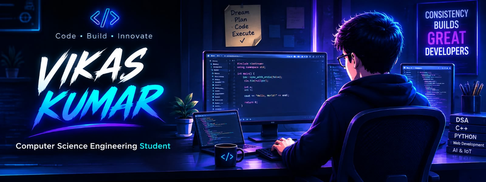

# Hi 👋, I'm Vikas Kumar

---

## 🖥️ SYSTEM INFORMATION

<table>
<tr>
<td><b>Name</b></td>
<td>Vikas Kumar</td>
</tr>
<tr>
<td><b>Education</b></td>
<td>B.Tech CSE</td>
</tr>
<tr>
<td><b>Role</b></td>
<td>Student</td>
</tr>
<tr>
<td><b>Focus</b></td>
<td>AI • Machine Learning • DSA</td>
</tr>
<tr>
<td><b>Learning</b></td>
<td>Python • Data Structures & Algorithms • Web Development</td>
</tr>
<tr>
<td><b>Goal</b></td>
<td>AI/ML Engineer</td>
</tr>
<tr>
<td><b>Status</b></td>
<td>Learning & Building</td>
</tr>
</table>

---

## 🚀 CURRENT MISSION

- 🎯 Data Structures & Algorithms
- 🎯 Learn Artificial Intelligence
- 🎯 Learn Machine Learning
- 🎯 Build Real World Projects
- 🎯 Contribute To Open Source
-
